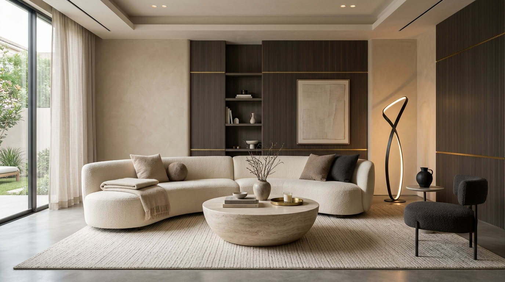

# TOLEX FURNITURE — Luxury Home Furniture Showroom

A premium, elegant, modern, fully responsive 4-page website for **TOLEX FURNITURE**, a high-end furniture showroom brand.



---

## 🛋️ Brand Overview

**TOLEX FURNITURE** is an independent luxury home furniture showroom committed to timeless elegance, solid timber craftsmanship, and welcoming living spaces.

- **Brand Personality**: Premium, warm, sophisticated, elegant, welcoming, and trustworthy.
- **Product Categories**:
  - Living Room Furniture (curved bouclé sofas, Italian leather sectionals, travertine tables)
  - Bedroom Furniture (platform beds, fluted nightstands, wardrobes, mattresses)
  - Dining Room Furniture (solid American walnut dining tables, sculptural chairs)
  - Executive Office Furniture (teakwood desks, ergonomic task chairs)
  - Home Decor & Consoles (architectural TV consoles, fluted lighting)

---

## 🎨 Color Palette

Extracted from the brand design system:

| Color | Hex | Role |
| :--- | :--- | :--- |
| **Charcoal Brown** | `#625956` / `#221E1D` | Strong visual weight, headers, contrast accents |
| **Warm Taupe** | `#A18B78` | Subheaders, category labels, subtle dividers |
| **Cream Beige** | `#E9D9C7` | Warm container backgrounds, card fills |
| **Muted Gold** | `#C5A66E` | Inlays, logo accents, active indicators, badges |
| **Warm White** | `#F9F6F0` | Clean editorial background canvas |
| **Wood Brown** | `#8B7666` | Natural timber accents |

---

## 📄 Website Structure

1. **Home (`index.html`)**
   - Slider Revolution-style animated hero with Ken Burns zoom and line-by-line staggered typography.
   - Welcome section with showroom statistics.
   - Interactive furniture product catalogue with live search and category filtering.
   - "Why Choose Us" featuring the 6 luxury brand pillars.
   - Service previews, curated interior gallery, customer testimonials carousel, and final CTA.
   - Shopping cart-style Enquiry Drawer with local storage and direct WhatsApp export.
2. **About Us (`about.html`)**
   - Our Story & Heritage, Who We Are.
   - Mission and Vision statements.
   - 6 Core Brand Values (Artisanal Mastery, Timeless Aesthetics, Sustainable Sourcing, Ergonomic Comfort, Bespoke Tailoring, Uncompromising Trust).
   - Why Customers Choose Us showroom experience breakdown.
3. **Our Services (`services.html`)**
   - All 8 comprehensive services: Living Room, Bedroom, Dining Room, Office Furniture, Home Furniture (Full Fitout), Selection Assistance, Consultation, Interior Styling.
   - Interactive specification modals for each service.
   - The 4-step consultation journey.
4. **Contact Us (`contact.html`)**
   - Interactive enquiry form with real-time field validation.
   - Showroom location, address, telephone, email, and visiting hours.
   - Direct WhatsApp hotline and driving directions card.

---

## ⚡ Technical Highlights

- **Pure Vanilla Stack**: HTML5, CSS3, and Vanilla JavaScript (zero framework or external build dependencies).
- **Custom Vector Branding**: Scalable SVG logo and favicon with stylized sofa and gold arch motif.
- **Shopping Cart-Style Enquiry Drawer**: Add/remove furniture pieces with persistent `localStorage` and one-click WhatsApp inquiry generation.
- **Responsive**: Fully responsive across mobile, tablet, laptop, and ultra-wide desktop displays with a smooth sliding mobile drawer.
- **Accessibility & SEO**: Semantic tags, ARIA attributes, meta descriptions, and accessible contrast ratios.

---

## 🚀 Getting Started

Simply clone this repository and open `index.html` in any modern web browser:

```bash
git clone https://github.com/<your-username>/tolex-furniture.git
cd tolex-furniture
# Open index.html in your browser
```

---

## 📄 License

This project is licensed under the MIT License — see the LICENSE file for details.
